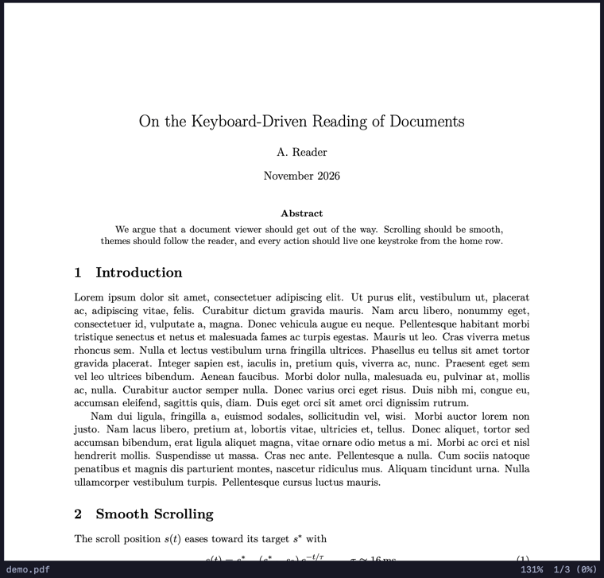
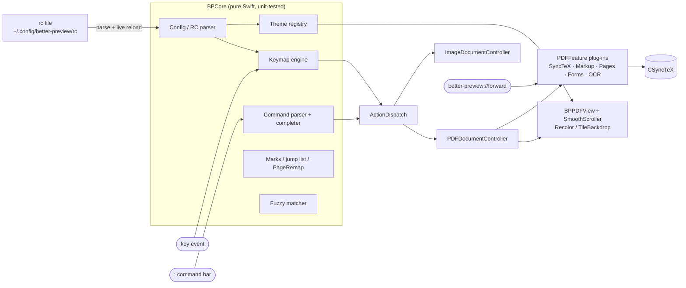

<div align="center">

# 📑 Better Preview

### *A native macOS viewer for people who never touch the mouse*




</div>

---

## Overview

Better Preview is Apple Preview's feature set (PDF markup, forms and signatures, page management, image editing, export) driven the way [zathura](https://pwmt.org/projects/zathura/) is: vim keys with counts, a `:` command line with completion, themes that recolor the page, a live-reloaded rc file, auto-reload on file change and SyncTeX in both directions.

It is a single Swift + AppKit + PDFKit app with **no third-party Swift dependencies** (the only vendored code is the MIT-licensed C SyncTeX parser). It was built to scroll smoothly and to stay light: on a 500-page PDF in a release build it opens to the first page in about 130–170 ms (warm), drops no frames while scrolling at 60 Hz, uses about 70 MB, and idles at 0% CPU.

> [!NOTE]
> Every option, default key map and theme is listed, commented, in [`docs/rc.example`](docs/rc.example). Review notes live in [`docs/review-fable.md`](docs/review-fable.md) and [`docs/review-perf.md`](docs/review-perf.md).

## Table of Contents

- [Features](#features)
- [Known Limitations](#known-limitations)
- [Toolchain](#toolchain)
- [Build & Run](#build--run)
- [Configuration](#configuration)
- [Input Reference](#input-reference)
- [Command Line](#command-line)
- [SyncTeX Integration](#synctex-integration)
- [System Architecture](#system-architecture)
- [Source Tree](#source-tree)
- [Testing & Debug Switches](#testing--debug-switches)
- [License](#license)

## Features

| | Area | Details |
| :-: | :--- | :--- |
| 📜 | **Reading** | Smooth scrolling across pages; continuous or single page; two-page (book) layout; fit width/page; zoom; rotate; outline; marks (`ma`, `'a`) and a jump list (`Ctrl-o` / `Ctrl-i`); search with highlights; trim margins; auto-reload when the file changes |
| 🎨 | **Themes & recolor** | 15 built-in UI themes plus your own (`theme-define`); page recoloring (`Ctrl-r`), with `recolor-keephue` to invert lightness only; `set theme auto` follows system light/dark |
| 🖍️ | **Markup** | Highlight / underline / strikethrough a selection (`gh` `gu` `gs`); note, text, rectangle, oval, line, arrow and freehand tools; delete with `x`; undo/redo throughout |
| 🗂️ | **Pages & sidebar** | Thumbnail sidebar (`Tab`); drag to reorder; rotate, delete, insert from a file or blank; export a range (`:page-export 3-5 out.pdf`) |
| ✍️ | **Forms & signatures** | Fill form fields (Esc leaves a field); create, manage and place signatures |
| 🖼️ | **Images** | Open any image; crop, resize, adjust colour, flip, rotate, copy, print, export |
| 🔎 | **OCR** | `:ocr [pages\|all] [save <path>]` runs Vision text recognition on pages with no text, after which search and copy work; `save` writes a searchable PDF; Esc cancels |
| 📽️ | **Presentation** | `F5` / `:pres`: full screen, one page per screen, its own key map |
| 📤 | **Export & print** | Export (Shift-Cmd-E), Save As, Print; `:w <path>` saves as and moves the window to the new file, like Preview; `:export <path> [png\|jpg\|tiff\|heic] [dpi]` writes one image per page |
| 🧭 | **Fuzzy opener** | `Ctrl-p` / `<Space>o` |
| 🔁 | **SyncTeX** | Cmd-click inverse search into your editor; forward search via a `better-preview://` URL ([details](#synctex-integration)) |

<details>
<summary><b>Built-in themes</b></summary>

`catppuccin-latte`, `catppuccin-frappe`, `catppuccin-macchiato`, `catppuccin-mocha`, `gruvbox-dark`, `gruvbox-light`, `nord`, `tokyo-night`, `tokyo-night-day`, `dracula`, `solarized-dark`, `solarized-light`, `rose-pine`, `rose-pine-moon`, `rose-pine-dawn`. Define your own with `theme-define <name> <dark|light> [from <theme>] ... theme-end`.

</details>

## Known Limitations

| Area | Limitation |
| :--- | :--- |
| Platform | macOS 27 only. Ad-hoc signed, not notarised: a copy from elsewhere may need right-click > Open on first launch |
| Launch Services | Keep **one** copy of the app registered, or `better-preview://` links and "Open With" may pick an older copy |
| PDFKit internals | Two are used defensively, each a no-op if a future macOS changes it: recolouring the white tile backdrop (prevents white flashes under recolor) and turning off PDFKit's automatic page analysis (`set pdfkit-analysis true` restores auto-detected form fields and automatic OCR of scans) |
| OCR | The first `ocr` after installing or updating waits ~20–30 s while macOS compiles Vision's models; later runs take under a second per page |
| Memory | ~70 MB on a 500-page PDF, ~100 MB after a full-document search; colour-adjusting a 48 MP image peaks near 1 GB |
| Images | Colour adjust renders in 8-bit sRGB (rotate, flip, crop and resize keep 16-bit and wide-gamut colour) |
| Encryption | A PDF opened with only its user password still allows markup, page edits and image export even if its permissions forbid them; removing the encryption needs the owner password |
| Blocking I/O | Save, export and print run on the main thread: very large PDFs block the window briefly, with no progress bar |
| Marks | Marks and the jump list follow page edits and OCR done inside the app; a file rewritten by another tool is reloaded as a new document |

Not included by design: link hints, visual/yank mode, tabs, session memory, a terminal launcher.

## Toolchain

| Requirement | Notes |
| :--- | :--- |
| macOS 27 | The package targets `.macOS("27.0")` |
| Swift 6 toolchain | `swift-tools-version: 6.0`; Xcode or the command-line tools |
| zlib | System library, linked by the vendored SyncTeX parser |
| `tectonic` *(optional)* | Only for the SyncTeX self-test |

## Build & Run

```sh
swift build                                   # debug build
swift test                                    # 138 unit tests (BPCore)
scripts/bundle.sh                             # release build -> "build/Better Preview.app" (icon, ad-hoc signed)
cp -R "build/Better Preview.app" /Applications/
open -a "Better Preview" file.pdf
```

`scripts/bundle.sh debug` builds a debug bundle. The icon is generated by `scripts/make-icon.swift`, which runs automatically when `Resources/AppIcon.icns` is missing or older than the script.

The app registers as an *alternate* handler for PDFs and images. To make it the default, pick it in Finder's **Get Info > Open With > Change All**.

> [!WARNING]
> Two registered copies (say `/Applications` and `build/`) make `open better-preview://...` and "Open With" pick one unpredictably. Delete stale copies, and if needed unregister one with:
> ```sh
> /System/Library/Frameworks/CoreServices.framework/Frameworks/LaunchServices.framework/Support/lsregister -u "<path of the stale copy>"
> ```

## Configuration

The config is a zathurarc-style text file at `~/.config/better-preview/rc` (`BP_RC=/some/file` points elsewhere). It is parsed on top of the built-in defaults and **reloaded live when you save it** (or run `:source`). Parse errors show in the status bar; the rest of the file still loads.

```sh
mkdir -p ~/.config/better-preview && cp docs/rc.example ~/.config/better-preview/rc
```

Everything in the example is commented out until you uncomment it.

```
set theme catppuccin-mocha
set recolor true
map <C-j> page-next
unmap ZQ
include ~/.config/better-preview/local.rc
```

| Statement | Meaning |
| :--- | :--- |
| `set <option> <value>` | Value may be `"quoted"`; booleans accept true/false, yes/no, on/off, 1/0 |
| `map [mode] <keys> <action> [arg]` | Modes: `normal` (default), `presentation`, `insert`, `command` |
| `unmap [mode] <keys>` | Remove a default or earlier binding |
| `include <path>` | Read another rc file, relative to this one; `~` allowed |
| `theme-define <name> <dark\|light> [from <theme>] ... theme-end` | Custom theme |

## Input Reference

Keys take a vim count (`5j`, `12G`). Multi-key maps wait `key-timeout` ms (default 700). Every key is rebindable.

<details open>
<summary><b>Normal mode</b></summary>

| Keys | Action |
| :--- | :--- |
| <kbd>j</kbd> `<Down>` `<C-e>` | `scroll-down` |
| <kbd>k</kbd> `<Up>` `<C-y>` | `scroll-up` |
| <kbd>h</kbd> `<Left>` | `scroll-left` (previous page when the page fits the window's width) |
| <kbd>l</kbd> `<Right>` | `scroll-right` (next page when the page fits the window's width) |
| `<C-d>` / `<C-u>` | `scroll-half-down` / `scroll-half-up` |
| `<C-f>` `<Space>` `<PageDown>` | `scroll-page-down` |
| `<C-b>` `<S-Space>` `<PageUp>` | `scroll-page-up` |
| `J` / `K` | `page-next` / `page-previous` |
| `gg` `<Home>` / `G` `<End>` | `goto-first` / `goto-last` |
| `+` `zi` / `-` `zo` / `=` `z0` | `zoom-in` / `zoom-out` / `zoom-reset` |
| `a` / `s` | `fit-page` / `fit-width` |
| `r` | `rotate-cw` |
| `d` / `c` | `toggle-dual-page` / `toggle-continuous` |
| `<C-r>` | `toggle-recolor` |
| `t` | `toggle-trim` |
| `/` `?` / `n` `N` | search forward / backward, next / previous |
| `m` / `'` `` ` `` | `mark-set` / `mark-jump` |
| `<C-o>` / `<C-i>` | `jump-back` / `jump-forward` |
| `<Tab>` / `T` / `<C-n>` | toggle sidebar / toolbar / status bar |
| `<F11>` / `<F5>` | `toggle-fullscreen` / `toggle-presentation` |
| `i` | `toggle-inspector` |
| `:` / `o` | command line / command line pre-filled with `open ` |
| `<Space>o` `<C-p>` | `open-palette` (fuzzy opener) |
| `<Esc>` | `abort` |
| `R` | `reload` |
| `q` `ZZ` / `ZQ` | `close` / `quit` |
| `gh` `gu` `gs` | highlight / underline / strikethrough the selection |
| `x` | `annotation-delete` |

</details>

<details>
<summary><b>Presentation mode</b> (<kbd>F5</kbd>)</summary>

| Keys | Action |
| :--- | :--- |
| `j` `l` `<Space>` `<Right>` `<Down>` `<PageDown>` | `page-next` |
| `k` `h` `<S-Space>` `<Left>` `<Up>` `<PageUp>` | `page-previous` |
| `gg` / `G` | `goto-first` / `goto-last` |
| `<C-r>` | `toggle-recolor` |
| `<Esc>` `q` `<F5>` | `toggle-presentation` |

</details>

> [!TIP]
> macOS menu shortcuts work too: Cmd-F find, Cmd-G next, Cmd-S save, Cmd-+/- zoom, Cmd-8/9/0 fit/zoom, Cmd-Shift-F presentation, Cmd-Shift-; command line, Cmd-Opt-G go to page, Cmd-R rotate right (reload is Cmd-Opt-R or `R`).

The status bar shows the file name, active flags, zoom and a zathura-style position such as `2/3 (41%)`.

## Command Line

`:` opens the command line: <kbd>Tab</kbd> completes commands, options, themes and paths; <kbd>Up</kbd>/<kbd>Down</kbd> walk the history. `/` and `?` search forward and backward (incremental, smart-case, wrapping by default).

- Every action name is a command with an optional argument: `:goto-page 40`, `:zoom-set 150`, `:ocr all`, `:annotate-highlight`.
- Rc statements work at runtime: `:set recolor true`, `:map J page-next`, `:unmap J`, `:theme nord`, `:source [file]`.

<details>
<summary><b>Aliases</b></summary>

| Alias | Command |
| :--- | :--- |
| `q` `quit` | close window |
| `qa` `qall` | quit app |
| `w` `write` | save; with a path, save as |
| `e` `edit` `o` | open |
| `r` | reload |
| `p` `hardcopy` | print |
| `g` `goto` | go to page |
| `zoom` | `zoom-set` |
| `hl` `highlight` / `nohl` `nohlsearch` | search highlights on / off |
| `so` | `source` |
| `colo` `colorscheme` | `theme` |
| `first` `last` `next` `n` `prev` `previous` `N` | navigation |
| `fs` `fullscreen`, `pres` `presentation`, `sidebar`, `toolbar`, `recolor`, `trim`, `dual`, `rotate` | toggles |

</details>

<details>
<summary><b>All actions</b></summary>

`scroll-*`, `page-next`, `goto-first`, `goto-last`, `zoom-in`, `zoom-out`, `zoom-reset`, `fit-page`, `fit-width`, `rotate-cw`, `rotate-ccw`, `toggle-dual-page`, `toggle-continuous`, `toggle-recolor`, `toggle-trim`, `toggle-sidebar`, `toggle-toolbar`, `toggle-statusbar`, `toggle-fullscreen`, `toggle-presentation`, `toggle-inspector`, `search-next`, `search-previous`, `search-clear`, `jump-back`, `jump-forward`, `open-palette`, `reload`, `save`, `save-as`, `export`, `print`, `undo`, `redo`, `copy`, `select-all`, `annotate-highlight|underline|strikethrough`, `tool-select|note|text|rectangle|oval|line|arrow|ink`, `annotation-delete`, `signature-place`, `signature-manage`, `page-delete`, `page-rotate-cw|ccw`, `page-insert [path]`, `page-insert-blank`, `page-export [ranges] [path] [force]`, `image-crop`, `image-resize <w>x<h>`, `image-adjust`, `image-flip-horizontal|vertical`, `ocr`, `synctex-forward`.

</details>

**OCR:** `:ocr` with no argument covers all text-less pages, or else the current one. `pages` is a range like `3-7,10`. `set ocr-languages "en-US,de-DE"` picks languages. OCR marks the document modified.

**Export:** `:export <path> [png|jpg|tiff|heic] [dpi]` writes `name-01.png`, `name-02.png`, …; paths with spaces go in double quotes; existing files are replaced only with `force`.

## SyncTeX Integration

Compile with SyncTeX on (`pdflatex -synctex=1`, `latexmk -synctex=1`, `tectonic --synctex`). `set synctex true` is the default.

**Inverse search** (Cmd-click the PDF to open the source line): set the editor command. `%{input}`, `%{line}` and `%{column}` are shell-quoted for you and run through `/bin/sh -c`.

```
set synctex-editor-command "code -g %{input}:%{line}"
set synctex-editor-command "subl %{input}:%{line}:%{column}"
set synctex-editor-command "nvim --server /tmp/nvim.sock --remote-send '<C-\\><C-n>:e %{input}<CR>:%{line}<CR>'"
```

**Forward search** (editor to PDF): the PDF is opened or brought forward and the location flashes.

```sh
open "better-preview://forward?line=42&src=/path/main.tex&pdf=/path/main.pdf"   # optional &column=
```

From inside the app: `:synctex-forward <line>[:col] [src]` (the source defaults to `<pdf name>.tex` next to the PDF).

<details>
<summary><b>vimtex</b></summary>

```vim
let g:vimtex_view_general_viewer = 'open'
let g:vimtex_view_general_options = '-g "better-preview://forward?line=@line&src=@tex&pdf=@pdf"'
```

</details>

<details>
<summary><b>LaTeX Workshop (VS Code)</b></summary>

```json
"latex-workshop.view.pdf.external.synctex.command": "open",
"latex-workshop.view.pdf.external.synctex.args": ["better-preview://forward?line=%LINE%&src=%TEX%&pdf=%PDF%"],
"latex-workshop.view.pdf.external.viewer.command": "open",
"latex-workshop.view.pdf.external.viewer.args": ["-a", "Better Preview", "%PDF%"]
```

</details>

## System Architecture



<details>
<summary><b>Feature plug-ins</b></summary>

PDF windows load `PDFFeature` plug-ins in order (SyncTeX first, then Markup, Pages, Forms, OCR). Each implements `commitPendingEdits()` (called before save/export) and `tearDown()`. Window-level `WindowFeature`s (Sidebar, Toolbar, Presentation) get `windowWillClose()`. Edits go through a `ChangeTrackingUndoManager`, which drives the dirty flag and close/quit prompts.

</details>

<details>
<summary><b>Rendering and smoothness</b></summary>

- `SmoothScroller` animates every scroll (shared by PDFs and images); `h`/`l` turn the page when it fits the window's width.
- Recolor uses a `RecolorPage` subclass; `TileBackdrop` recolours PDFKit's internal white tile layer so pages never flash white while scrolling (a no-op fallback if the layer is not found).
- `PDFKitTuning` turns off PDFKit's automatic page analysis, which otherwise runs form detection and OCR on every visible page.
- Defaults and themes are compiled into the binary (`DefaultConfig.swift`, `Theme/Presets.swift`), not loaded from resource files.

</details>

## Source Tree

```
better-preview
├── Package.swift            SwiftPM manifest: BPCore, CSyncTeX, BetterPreview, BPCoreTests
├── Resources/               Info.plist, AppIcon.icns
├── scripts/
│   ├── bundle.sh            release/debug build -> "build/Better Preview.app", ad-hoc signed
│   ├── make-icon.swift      generates the app icon
│   └── make-test-assets.swift   500-page PDF, short PDF, images -> build/test-assets/
├── docs/                    rc.example, review notes, demo.gif
├── Sources/
│   ├── BPCore/              pure Swift: Config, Theme, Keys, Commands, Fuzzy, Nav
│   ├── CSyncTeX/            vendored synctex_parser v1.21 (MIT)
│   └── BetterPreview/
│       ├── App/             launch, URL scheme, menus, debug driver and snapshots
│       ├── Actions/         action dispatch, ChangeTrackingUndoManager
│       ├── Window/          window, keys, command bar, saving, config, marks, toolbar
│       ├── PDF/             viewer, SmoothScroller, recolor, TileBackdrop, search, trim
│       ├── Image/           image documents: crop, resize, adjust, frames
│       ├── Markup/          annotation tools, inspector, overlay
│       ├── Pages/           page management and thumbnail sidebar
│       ├── Forms/           form fields and signatures
│       ├── SyncTeX/         forward/inverse search
│       ├── OCR/             Vision text recognition
│       ├── Presentation/    full-screen presentation mode
│       ├── Export/          export, encryption, print, quit review
│       └── Features/        file watcher, fuzzy opener palette
└── Tests/BPCoreTests/       unit tests for BPCore
```

## Testing & Debug Switches

```sh
swift test                                    # BPCore unit tests
swift scripts/make-test-assets.swift          # build/test-assets/: long.pdf (500 pages), short.pdf, images
```

Self-tests open a window, run their checks, print `... SELFTEST PASS` and exit non-zero on failure:

| Variable | Checks |
| :--- | :--- |
| `BP_SELFTEST=recolor\|trim\|outline\|markup\|pages\|forms\|all` | core PDF features |
| `BP_OCR_SELFTEST=1` | OCR |
| `BP_PRESENTATION_SELFTEST=1` | presentation mode (use `long.pdf`) |
| `BP_SYNCTEX_SELFTEST=1` | SyncTeX (a PDF built with `tectonic --synctex`) |
| `BP_EXPORT_SELFTEST=1` | export |

<details>
<summary><b>Headless driver and other switches</b></summary>

`BP_SCRIPT="step;step;..."` drives the first window without input and prints a `STATUS ...` line to stderr after each step. `BP_SCRIPT_DELAY` sets the gap (default 0.4 s). The demo GIF above was recorded this way.

| Step | Effect |
| :--- | :--- |
| `<action> [arg]` / `<n>:<action>` | run an action, optionally n times |
| `keys <vim keys>` | key strokes through the normal key path |
| `post <chars>` | real NSEvent key-downs |
| `type <text>` / `enter` / `escape` | drive the input bar |
| `cmd <line>` | run a `:` command line |
| `snapshot <png>` | render the window, PDF pages included |
| `sleep <s>` / `quit` | timing / exit |

```sh
BP_SCRIPT="sleep 1;keys 5j;cmd theme nord;snapshot out.png;quit" \
  "build/Better Preview.app/Contents/MacOS/BetterPreview" file.pdf
```

| Variable | Effect |
| :--- | :--- |
| `BP_RC=<path>` | use another rc file |
| `BP_SIGNATURE_DIR=<dir>` | keep signatures out of the real store |
| `BP_SCROLL_STATS=1` | frame-timing stats while scrolling |
| `BP_LAUNCH_TIMING=1` | launch timing |
| `BP_TILE_DEBUG=1` | tile-layer diagnostics |
| `BP_PDFKIT_ANALYSIS=1` | turn PDFKit page analysis back on |
| `BP_PDF_PASSWORD` / `BP_PDF_OWNER_PASSWORD` | unlock encrypted PDFs without the prompt |
| `BP_PALETTE_TEST=<query>` | print fuzzy-opener results |

</details>

## License

[MIT](LICENSE). The vendored SyncTeX parser in `Sources/CSyncTeX/` is MIT-licensed by its authors; see [`Sources/CSyncTeX/LICENSE`](Sources/CSyncTeX/LICENSE).

---

<div align="center">

*"Read fast. Mark up. :wq."*

</div>
